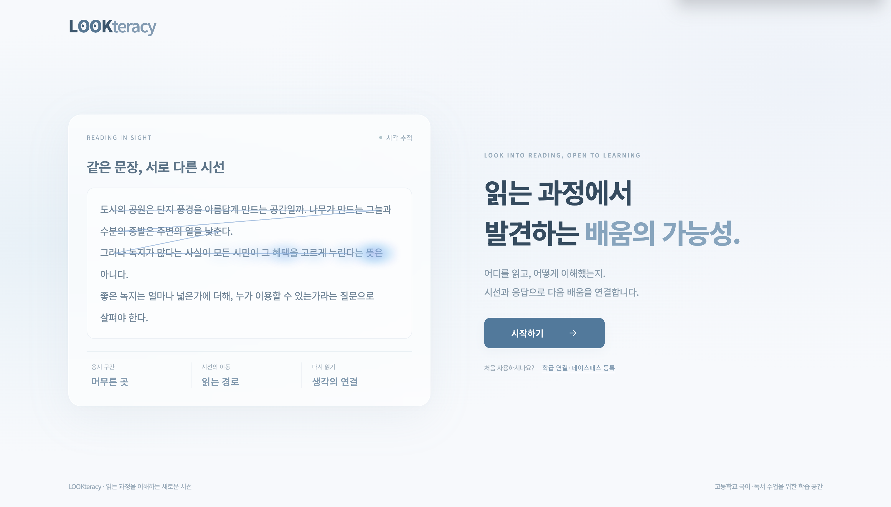
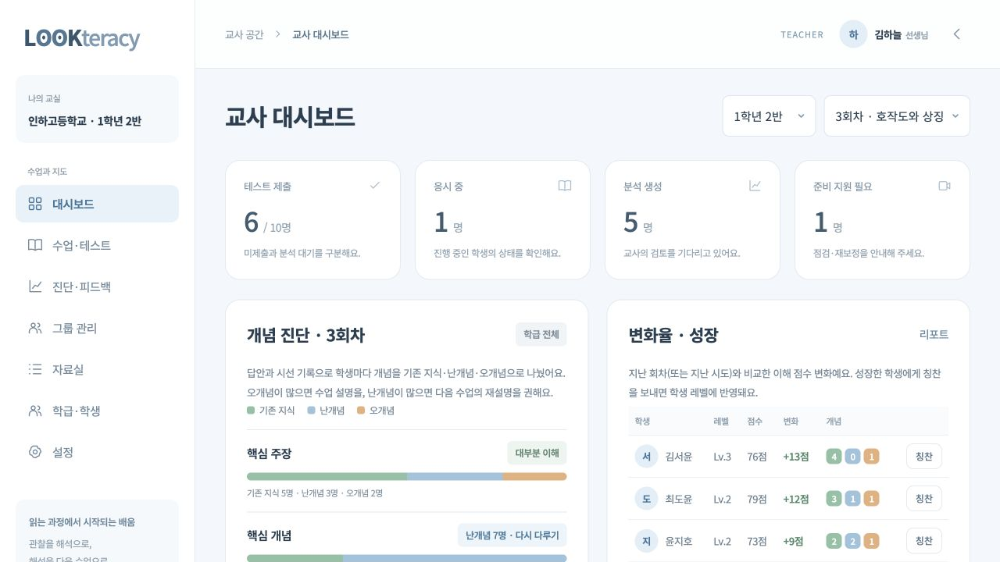
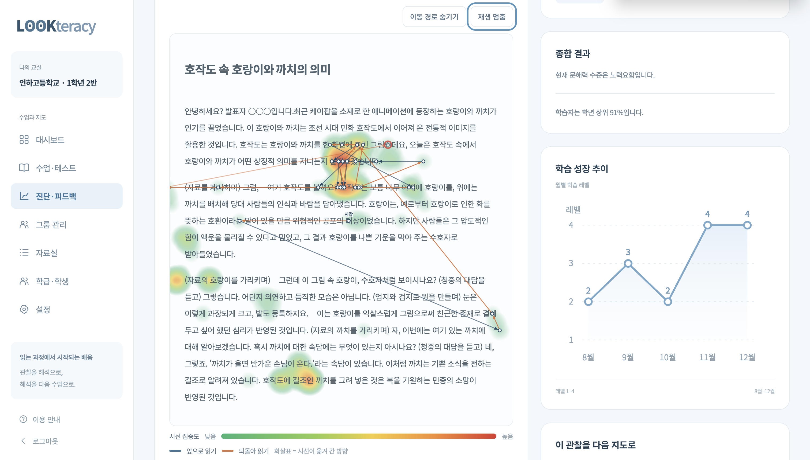

# LOOKteracy

웹캠으로 학생의 읽기 과정을 기록하고, 답안과 함께 분석해 교사의 개별 피드백과 수업 설계를 돕는 문해력 학습 서비스입니다.

2026 INHA AX-EDU 해커톤에서 개발했으며, 최우수상(2위)을 수상했습니다.



## 기획 배경

디지털 환경에서 긴 글을 읽고 논리적으로 이해하는 어려움에 주목했습니다. 글을 끝까지 읽어도 내용을 연결하지 못하거나, 어디에서 막혔는지 스스로 설명하기 어려운 학생이 있습니다. 교사 역시 정답 여부만으로는 학생이 글을 어떻게 읽고 이해했는지 파악하기 어렵습니다.

LOOKteracy는 학생이 지문을 읽는 동안 어느 부분에 오래 머물렀고, 어디로 돌아가 다시 읽었는지를 기록합니다. 여기에 선택형·서술형 답안을 함께 살펴 교사가 추가로 확인할 부분과 다음 읽기 전략을 정리할 수 있도록 했습니다.

수업 초반의 읽기 활동을 개인별 피드백과 협력 학습으로 이어가는 것이 목표입니다. 학생은 자신의 읽기 습관을 돌아보고, 교사는 공통적인 어려움을 참고해 설명과 발문, 모둠 활동을 조정할 수 있습니다.

## 주요 기능

| 기능 | 내용 |
|---|---|
| 얼굴 인증 로그인 | 얼굴 특징값 비교와 눈 깜빡임 확인으로 학생·교사 계정에 접속합니다. |
| 읽기 과정 기록 | 시선 보정 후 지문을 읽는 동안 좌표를 수집하고, 응시 시간·되돌아 읽기·주의 이탈 등을 계산합니다. |
| 답안 평가 | 선택형 정답 비교와 서술형 루브릭 채점을 수행합니다. 설정에 따라 Claude로 서술형을 다시 채점할 수 있습니다. |
| 개념 진단 | 답안과 유효 시선 기록을 바탕으로 개념의 이해 상태를 기존 지식·난개념·오개념으로 분류합니다. |
| 교사 리포트 | 히트맵·시선 경로·단어별 지표와 문항 응답을 함께 확인합니다. 읽기 유창성, 핵심 내용 파악, 맥락 파악, 추론 능력, 비판적 읽기의 5개 영역으로 정리합니다. |
| 개인 피드백 | 교사가 분석 초안을 불러와 강점·보완할 점·다음 읽기 전략을 편집하고 학생에게 게시합니다. |
| 모둠 편성 | 이해 점수에 따른 멘토형·수준별 모둠을 추천하고, 교사가 직접 그룹을 구성·저장합니다. |
| 성장 기록 | 응시 시도별 점수 변화, 목표, 칭찬과 레벨을 확인합니다. |



## 사용 흐름

1. 학생이 얼굴을 등록하고 로그인합니다.
2. 오늘의 테스트에서 카메라를 점검하고 시선을 보정합니다.
3. 지문을 읽은 뒤 선택형 1문항과 서술형 2문항에 응답합니다.
4. 교사는 학생별 리포트에서 시선 기록과 답안을 확인합니다.
5. 개인 피드백을 편집·게시하고, 후속 지도와 모둠 구성을 준비합니다.
6. 학생은 게시된 피드백과 성장 기록을 확인합니다.

## 구현 방식

| 기술 | 역할 |
|---|---|
| HTML·CSS·JavaScript | 학생 학습 화면, 교사 대시보드, 리포트와 피드백 화면 |
| face-api.js | 128차원 얼굴 특징값 추출과 등록 정보 비교 |
| MediaPipe | 눈 깜빡임 확인, WebGazer의 얼굴 특징점 추적 |
| WebGazer.js | 웹캠 기반 시선 좌표 추정 |
| Node.js | 로컬 정적 파일 서버와 선택적 채점 API |
| Claude API | 서술형 재채점과 피드백 초안 생성. 별도 설정 시 사용 |

### 시선 분석

9점 보정으로 화면 좌표를 학습하고, 읽는 동안 수집한 좌표를 본문 위치에 연결합니다. 좌표를 정제한 뒤 I-DT 방식으로 고정점을 추출해 히트맵과 이동 경로, 단어별 응시 지표를 계산합니다.

시선 분석 리포트 보기



## 실행

Chrome 또는 Edge와 웹캠이 필요합니다. 로컬 서버를 사용할 때는 Node.js 20.12 이상이 필요합니다.

### 파일로 열기

1. 프로젝트를 내려받고 압축을 모두 풉니다.
2. 폴더 안의 `LOOKteracy.html`을 Chrome 또는 Edge로 엽니다.
3. 얼굴 등록이나 학습 준비 단계에서 카메라 사용을 허용합니다.

### 로컬 서버로 열기

프로젝트 폴더에서 실행합니다.

```bash
node scripts/serve.mjs
```

브라우저에서 [http://127.0.0.1:4186](http://127.0.0.1:4186)으로 접속합니다.

## 구현 범위

현재 버전은 해커톤 프로토타입입니다. 학급 샘플·과거 기록·월별 성장 그래프, OCR, A~D 유형 분류와 PNG 출력에는 시연용 데이터를 사용합니다.

## 팀

| 이름 | 학과 | 담당 |
|---|---|---|
| 장소현 | 인공지능공학과 | 프론트엔드·기획 |
| 홍태양 | 인공지능공학과 | 백엔드·기술 구현 |
| 김나림 | 국어교육과 | 기획·교육 관련 자료조사 |
| 김아영 | 국어교육과 | 기획·교육 관련 자료조사 |

## 오픈소스와 자료 출처

| 구성 요소 | 라이선스 |
|---|---|
| @vladmandic/face-api 1.7.15 | MIT |
| WebGazer.js 3.5.3 | GPL-3.0-or-later |
| MediaPipe Tasks Vision·Face Mesh, TensorFlow.js | Apache-2.0 |
| Anthropic TypeScript SDK | Apache-2.0 |
| Noto Sans KR | OFL-1.1 |

시연 지문은 [2026학년도 3월 고1 전국연합학력평가 국어 1~3번 지문]을 발췌·편집했으며, 문항과 루브릭은 별도로 작성했습니다.
